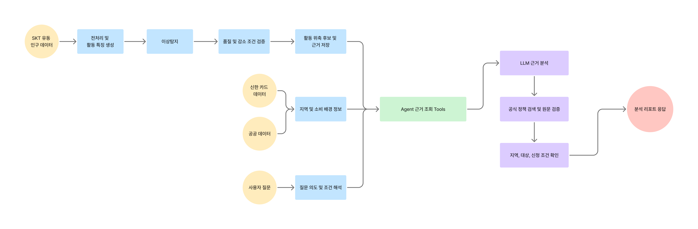

# 📢 사회활동 위축 탐지 및 예방 AI Agent


**2026 빅콘테스트 | AI데이터 활용 분야**  
**주제: 사회적 고립 예방 및 대응을 위한 AI 에이전트 개발**

본 프로젝트는 SKT 유동인구, 신한카드 소비 집계 및 공공 통계를 활용해 **활동 패턴이 이례적으로 위축된 지역 및 집단을 탐색**합니다. 비지도 이상탐지 모델이 후보를 선정하면 AI Agent가 근거를 분석하고 공식 복지정책을 연결해 후속 확인과 지원 연계를 돕습니다. 

> ⚠️
> 탐지 결과는 **개인의 사회고립 판정이나 고립 확률이 아닙니다.** 분석 단위는 지역·성별·연령대·월별 집계이며, 현장 확인을 위한 **활동 위축 후보**로 해석해야 합니다.

⠀ 
## 목차

1. [대회 주제 및 목적](#1-대회-주제-및-목적)
2. [활용 데이터 구성](#2-활용-데이터-구성)
3. [활동 위축 이상탐지 모델](#3-활동-위축-이상탐지-모델)
4. [전체 AI Agent 파이프라인](#4-전체-ai-agent-파이프라인)
5. [설치 및 실행법](#5-설치-및-실행법)
6. [프로젝트 구조](#6-프로젝트-구조)

⠀ 
## 1. 대회 주제 및 목적

사회적 고립 문제는 사후 대응뿐 아니라 **활동 변화의 조기 발견과 적절한 지역사회 지원**이 중요합니다. 본 프로젝트는 데이터 기반으로 이상 징후를 탐색하고, 탐지 결과와 실제 지원 자원을 연결하는 의사결정 지원 Agent를  목표합니다. 

| 단계 | 목표 | 주요 기능 |
|---|---|---|
| **Detect** | 위축 징후 조기 탐색 | 지역·성·연령 집단의 유동 변화 기반 비지도 이상탐지 |
| **Explain** | 판단 근거 제시 | 감소 지표, 유사 집단 비교, 데이터 품질 및 후보 선정 사유 조회 |
| **Connect** | 예방 및 대응 지원 | 중앙정부와 지자체 정책 검색, 공식 원문 검증, 관련 서비스 안내 |

✅모델 점수만으로 위험을 확정하지 않고, *이상 점수 → 감소 및 품질 조건 확인 → 근거 분석 → 정책 검토*의 과정으로 진행됩니다.
 
⠀ 
## 2. 활용 데이터 구성

| 데이터 | 주요 항목 | 활용 목적 | 출 |
|---|---|---|---|
| **SKT 성·연령별 유동인구** | 월, 소지역, 성별, 10세 단위 연령별 유동량 | 집단 활동 감소 및 상대 감소 분석 | 대회 제공 데이터
| **SKT 시간대별 유동인구** | 소지역별 0~23시 일평균 유동량 | 소지역 전체의 시간대별 활동 변화 | 대회 제공 데이터
| **SKT 요일별 유동인구** | 소지역별 월~일 일평균 유동량 | 소지역 전체의 평일과 주말 간 활동 변화 | 대회 제공 데이터
| **신한카드 소비 집계** | 가맹점 소재 시군구, 업종, 고객 집단, 결제금액 및 건수 | 소비활동 변화와 지역 맥락 분석 | 대회 제공 데이터
| **공공 구조 통계** | 1인가구, 독거노인, 주민등록 세대수, 고독사 현황 등 | 구조적 취약성, 지역 배경 참고 | 공공 데이터 포털 (https://www.data.go.kr/)
| **공식 복지정책 정보** | 지역, 대상, 서비스, 신청 방법·기간 | 관련 지원 정책의 검색·검증·추천 | 각 지자체 홈페이지 및 중앙정부 홈페이지


대회 제공 데이터는 저장소에 포함하지 않습니다. 고로 재현을 위해선 유사 데이터를 별도로 확보할 것을 권장드립니다. 🙇‍♂️

⠀ 
## 3. 활동 위축 이상탐지 모델

### 3.1. 모델 및 특징량

실제 사회고립 정답 라벨이 없기 때문에 **Isolation Forest 기반 비지도 이상탐지**를 사용합니다. 현재 운영 모델은 특징량 실험에서 선택한 `IF_F2` 모델입니다.

- **기본 6개 특징량(F0):** 현재·직전의 집단 유동 감소율, 소지역 전체의 낮 활동 감소율, 주말 활동 감소율
- **추가 2개 특징량(F2):** 지역 전체 대비 집단의 **상대 감소율**, 지역 내 해당 집단의 **유동 비중 변화**

활동 감소율은 현재 월의 유동량을 직전 2개월 평균과 비교해 계산합니다.

$$
\text{Decline}_t = \frac{\text{Mean}(F_{t-2},F_{t-1})-F_t}{\text{Mean}(F_{t-2},F_{t-1})}
$$

양수는 감소, 음수는 증가를 나타냅니다. 

이때 낮과 주말의 활동 변화는 특정 성·연령 집단이 아니라 **해당 소지역 전체의 보조 신호**로 사용합니다.

⠀ 
### 3.2. 학습 및 후보 선정

| 항목 | 설정 |
|---|---|
| 학습 기간 | 2025년 10월 |
| 평가 기간 | 2025년 11~12월 |
| 지역 | 서울, 강원 |
| 관측 단위 | 소지역 × 성별 × 연령 × 월 |
| 데이터 분할 | 소지역 기준 8:2 Group Split (학습 / 임계값 보정) |
| 이상 경계 | 보정 표본의 이상 점수 **95% 분위수** |
| 운영 모델 | Isolation Forest `IF_F2` (8개 특징량) |

최종 후보는 **① 모델 점수 경계 초과 ② 집단 유동 10% 이상 감소 ③ 소지역 전체 낮 또는 주말 활동 감소 ④ 충분한 품질·관측 범위**를 함께 충족해야 합니다. 이때, 소량 유동 및 결측·관측 범위 부족 사례는 임의로 0을 채우는 대신 판정을 보류합니다.

⠀ 

### 3.3. 모델 비교 결과

정답 데이터의 부재를 보완하기 위해 **Synthetic Anomaly Injection**으로 유동량을 인위적으로 변화시킨 뒤 후보 선정률을 비교했습니다.

| 모델 | S1: 특정 집단 30% 감소 | S7: 지역 공통 감소 |
|---|---:|---:|
| `IF_F0` (Baseline)| 15.6% | 15.6% |
| `IF_F2` | **61.5%** | **10.4%** |
| `IF_F4` (전체 신규 특징) | 62.5% | 17.7% |
| `KNN_F4` | 68.8% | 66.7% |
| `LOF_F4` | 65.6% | 69.8% |

`IF_F2`는 **특정 집단의 선택적 감소**에는 민감하면서 지역 전체의 공통 감소에는 비교적 낮게 반응하여 운영 모델로 선택했습니다. (KNN과 LOF는 S1 반응률은 높지만 공통 감소에도 민감했습니다.)

> ⚠️
> 이 표는 **합성 변화에 대한 후보 선정률**입니다. 실제 사회고립 탐지의 정확도나 재현율은 아니며, S7 지역 공통 감소가 무조건 오탐이라는 뜻도 아닙니다. 자세한 실험 조건은 [`docs/anomaly-experiments.md`](docs/anomaly-experiments.md)를 참고하세요.

⠀ 
## 4. 전체 AI Agent 파이프라인

<p align="center">
  
</p>

### 4.1. Agent 분석 Tool

| Tool | 기능 |
|---|---|
| `candidates`, `candidate_evidence` | 이상 후보 조회, 점수·감소·품질·선정 근거 반환 |
| `rank_activity_declines`, `get_evidence` | 일반 활동 감소 순위 및 상세 근거 |
| `compare_peers` | 활동 규모와 조건이 유사한 집단 비교 |
| `get_local_patterns` | 해당 소지역 전체의 낮·주말 활동 패턴 |
| `get_card_context` | 제공 범위 내 시군구 소비 맥락 |

⠀ 

### 4.2. 복지정책 검색 및 검증

복지정책 조회가 요청되면 Agent는 지역·연령·지원 목적과 확인된 활동 감소 근거를 사용해 탐색합니다.

1. **공식 출처 검색:** 중앙정부 및 지역 공식 사이트에서 정책 후보를 수집합니다.
2. **원문 검증:** 실제 HTML 본문을 확인하고 대상, 신청 방법, 기간, 적용 지역을 추출합니다.
3. **후보 평가:** 지원 목적 관련성(40%), 지역 적합성(25%), 신청 경로 등 실행 가능성(20%), 근거 충실도(15%)를 기준으로 정렬합니다.
4. **탐색 보완:** 후보가 부족하면 Agent가 *지역 서비스 / 전국 제도 / 탐지 사항 관련 지원* 중 다음 탐색 방향을 선택합니다. 실제 검색과 조건 검증은 코드가 수행합니다.
5. **결과 제시:** 확인된 지원 조건과 미확인 사항을 구분하고, 정책과 탐지 결과를 연결한 근거 ID를 제공합니다.

* 정책 탐색은 기본적으로 **최대 3회 탐색**, 전체 **60초 한도**로 제한됩니다. 
* 정책의 현재 접수 여부나 개별 자격이 확인되지 않으면 **확인 필요**로 별도 표시하여 제공합니다. 
* 정책 순위 점수는 수급 가능성이나 정책 효과 확률이 아닙니다.

⠀ 
### 4.3. LLM 기반 응답

Agent는 기본 조회 모드와 **LLM 기반 자연어 분석 모드**를 지원합니다.

```text
사용자 질문
  → LLM의 조회 조건 해석
  → 검증된 Tool 결과 조회
  → 필요 시 공식 정책 검색·검증
  → 근거 중심 한국어 분석 리포트 생성
```

* LLM은 **질문 해석, 결과 설명, 검색 전략 선택**을 담당 / 이상 점수 계산, 데이터 품질 검사, 정책 자격 조건 검증은 코드가 담당합니다. 
* 생성 답변에 근거 없는 수치나 URL이 포함되면 검증을 통과한 답변으로 채택하지 않고 기본 조회 모드로 찾은 근거만 제공합니다.

⠀ 
## 5. 설치 및 실행법


### 5.1. 환경 설정 및 패키지 설치

✔️Python 3.11 이상을 사용하며, 모든 명령어는 Linux 서버의 프로젝트 루트 디렉터리에서 실행합니다.

```bash
# Python 가상환경 생성
python3 -m venv .venv

# 가상환경 활성화
source .venv/bin/activate

# pip 업데이트
python -m pip install --upgrade pip

# 의존성 패키지 설치
pip install -r requirements.txt

# 프로젝트 패키지 설치
pip install -e . --no-deps
```

⠀ 
### 5.2. 데이터 전처리 및 기본 파이프라인

```bash
# 데이터 검증 및 정제
python -B -m activity_agent validate
python -B -m activity_agent preprocess

# 특징량 생성
python -B -m activity_agent features

# 전체 기본 활동 분석 파이프라인 실행
python -B -m activity_agent run-all
```

`run-all`은 데이터 정제, 특징량 생성, 기본 활동 탐지 및 보고서 생성을 순차적으로 수행하며, 앞선 단계별 명령은 개별 검증이 필요한 경우에 사용합니다. (처음부터 전체 실행할 때는 `run-all`만 실행해도 됩니다!)

⠀ 
### 5.3. 운영 IF_F2 모델 추론

`config/default.json`의 `isolation.model_id=IF_F2`와 `isolation.model_path`가 저장된 IF_F2 모델을 가리키도록 설정합니다.

```bash
# SGIS 경계 파일 기반 공간 연결 후보 확인 (최초 준비 시)
python -B -m activity_agent spatial-audit \
  --boundary-file data/boundaries/sido_2025/bnd_sido_00_2025_2Q.shp

# 저장된 모델로 이상탐지 수행
python -B -m activity_agent detect --task isolation

# 모델 평가
python -B -m activity_agent evaluate --task isolation

# 활동 위축 후보 및 탐지 근거 조회
python -B -m activity_agent ask \
  --task isolation \
  --backend local \
  "2025년 12월 강원 50대 남성 활동 위축 근거"
```

공간 연결에 필요한 자료와 학습된 모델이 사전에 준비되어 있어야 합니다. 

⠀ 
### 5.4. LLM 및 실시간 복지정책 검색

LLM 기반 자연어 질의와 실시간 복지정책 검색을 위해 vLLM 서버와 Tavily API를 연결합니다.

```bash
# vLLM 서버 설정
export VLLM_BASE_URL="http://localhost:{포트번호}/v1"
export VLLM_MODEL="활용할 모델명"
export AGENT_BACKEND="vllm"

# 실시간 정책 검색 API 키 설정
export TAVILY_API_KEY="YOUR_TAVILY_API_KEY"

# vLLM 연결 확인
python -B -m activity_agent llm-check

# AI Agent 실행
python -B -m activity_agent ask \
  --task isolation \
  --backend vllm \
  "2025년 12월 강원 50대 남성 활동 위축과 복지정책 추천"
```

vLLM은 별도로 실행 중인 추론 서버가 필요하며, 다른 서버에서 모델을 제공하는 경우 `VLLM_BASE_URL`을 해당 서버 주소로 변경해야 합니다.


⠀ 
### 5.5. Streamlit 대시보드

```bash
python -B -m activity_agent dashboard
```

기본 접속 주소는 `http://localhost:8501`입니다.

원격 Linux 서버에서 실행할 경우 로컬 PC에서 SSH 포트 포워딩을 설정한 뒤 브라우저로 접속할 수 있습니다.

```bash
# 로컬 PC 터미널에서 실행
ssh -L 8501:localhost:8501 USER@SERVER_IP
```

대시보드에서는 활동 위축 탐지 결과, 후보별 상세 근거, 복지정책 조회 및 Agent 질의응답을 확인할 수 있습니다.

⠀ 
### 5.6. 모델 비교 실험 및 HTML 결과

```bash
# 특징량 Ablation, 모델 비교, 합성 이상 주입 실험
python -B -m activity_agent experiment --suite all

# 테스트 실행
python -B -m pytest -q
```

실험 결과는 다음 디렉터리에 저장됩니다.

```text
artifacts/isolation/experiments/<run_id>/index.html
```

생성된 HTML 리포트에서는 특징량 Ablation, 비지도 모델 비교, Synthetic Anomaly Injection 및 지역과 시간별 진단 결과를 확인할 수 있습니다.

⠀ ⠀ 
## 6. 프로젝트 구조

```text
activity_agent/
├── common/       # 설정·평가·저장
├── data/         # 원자료 정제·집계
├── activity/     # 일반 활동 분석
├── isolation/    # 비지도 이상탐지·확장 실험
├── policies/     # 공식 복지정책 검색·검증
├── llm/          # vLLM 연동 및 설명 생성
├── ui/           # 대시보드
└── cli.py
config/default.json
references/
artifacts/
```

| 산출물 | 설명 |
|---|---|
| `artifacts/clean/`, `artifacts/quality.json` | 정제 데이터와 원자료 품질 점검 |
| `artifacts/features.parquet` | 지역·집단별 활동 특징량 |
| `artifacts/isolation/anomaly/` | 비지도 탐지 점수, 후보, 품질·판정 근거 |
| `activity_agent/model/experiments/<run_id>/IF_F2.pkl` | 선택된 IF_F2 모델 파일(모델 경로는 설정 참조) |
| `artifacts/isolation/experiments/<run_id>/index.html` | 모델·특징량 비교 실험의 HTML 리포트 |
| `artifacts/policies/lookups/` | 검색·검증된 정책 근거와 조회 기록 |
| `artifacts/reviews.sqlite3` | 검토 및 라벨 변경 이력 |

⚠️ 원자료, 모델 실행 산출물, 개인 API 키 및 가상환경 파일은 저장소에 포함하지 않도록 관리합니다.

⠀ ⠀ 
--
📄**상세 기술 문서**

- [모델 실험 및 평가](docs/anomaly-experiments.md)
- [IF_F2 실행 가이드](docs/f2-deployment.md)
- [정책 검색·추천 설계](docs/policy-recommendation.md)
- [Agent 근거 데이터 계약](docs/agent-evidence.md)
- [비지도 탐지 모델 상세](docs/activity-anomaly-model.md)

🧑‍🤝‍🧑**본 프로젝트는 사회고립을 단정하기보다, 활동 위축의 근거를 제시하고 적절한 후속 확인과 공공 지원을 돕는 AI 시스템을 지향합니다.**🌱
